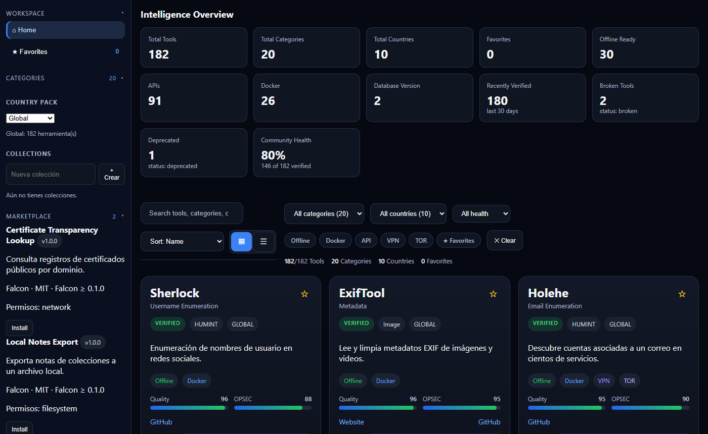
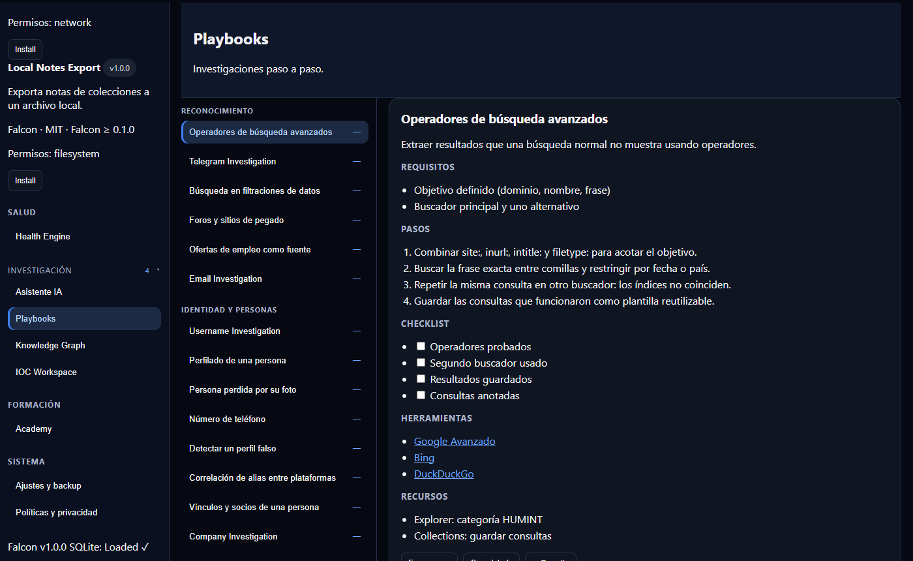
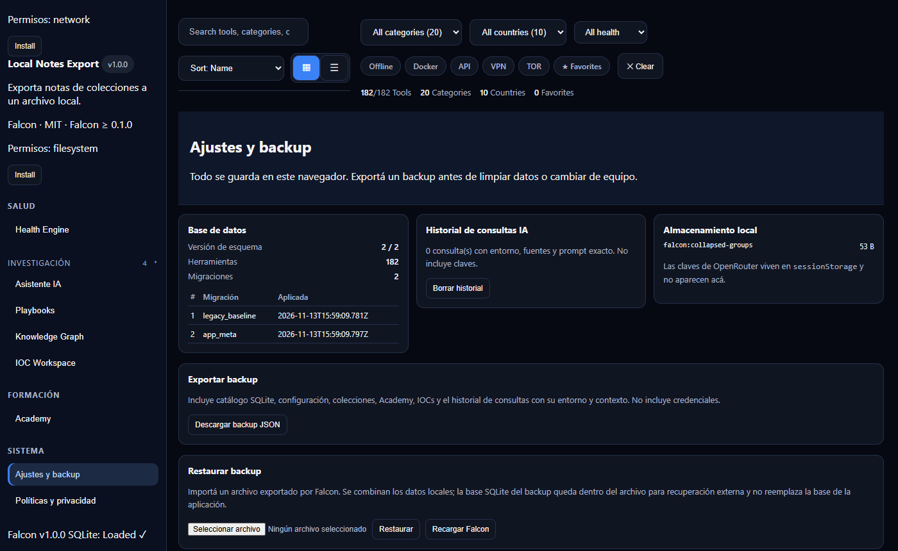

# Falcon OSINT Framework


Workspace de investigación OSINT **offline-first**: catálogo curado de fuentes,
base SQLite local, playbooks paso a paso, grafo de entidades, IOC workspace y un
asistente de IA opcional. Todo corre en el navegador; nada de lo que investigás
sale de tu equipo salvo que vos lo envíes.

**[Abrir la demo](https://furuko06.github.io/Falcon-OSINT-Framework/)** ·
[Notas de 1.0.0](docs/releases/1.0.0.md) ·
[Uso lícito](docs/legal/LAWFUL_USE.md) ·
[Informe de gates](docs/audits/GATES_REPORT.md)



## Qué incluye

- **Catálogo de 182 herramientas** en 20 categorías y 10 países, con estado de
  procedencia (`verified`, `restricted`, `broken`, `deprecated`), fecha de última
  verificación, licencia, scores de calidad y OPSEC.
- **SQLite en el navegador** (WASM): búsqueda y filtros sin backend.
- **Offline real**: service worker, backup con checksum y recuperación ante base
  corrupta o migración fallida.
- **Playbooks** por táctica, con checklist y progreso local.
- **Knowledge Graph** de entidades y relaciones, **IOC workspace** con estados y
  severidad, **Collections** para agrupar casos y exportarlos.
- **Asistente IA opcional** vía OpenRouter (OAuth PKCE) u Ollama local; la clave
  vive solo en `sessionStorage` y no se incluye en los backups.
- **PWA instalable**, sin telemetría, sin fuentes remotas, con CSP estricta.

| Playbooks | Ajustes y backup |
| --- | --- |
|  |  |

## Inicio rápido

La app necesita un servidor HTTP: abrir `index.html` con doble clic no funciona
(el navegador bloquea módulos ES y la carga de la base).

```bash
git clone https://github.com/furuko06/Falcon-OSINT-Framework.git
cd Falcon-OSINT-Framework
npm install
npm run dev          # http://localhost:5173/
```

Build de producción:

```bash
npm run build && npm run preview
```

## Datos y procedencia

`intelligence/` guarda el catálogo como JSON, las categorías, los packs de país y
el esquema. `npm run db:import` lo compila en `database/falcon.db`; la importación
es idempotente (una segunda corrida reporta `0 inserted, 0 updated`) y elimina del
catálogo las entradas que ya no están en el JSON.

```bash
npm run db:validate      # valida todos los JSON
npm run db:import        # JSON → SQLite
npm run db:compile       # estadísticas del catálogo
npm run db:provenance    # exige estado y fecha de verificación vigente
npm run db:verify        # revisa las URLs (--dry-run no escribe)
```

Un workflow semanal ([`source-health.yml`](.github/workflows/source-health.yml))
revisa las 182 fuentes y publica el resultado en el resumen del run. No bloquea el
build, el despliegue ni el uso offline.

## Asistente de IA

En **Asistente IA → Conectar IA** autorizás con OpenRouter o apuntás a tu Ollama
local. Las respuestas muestran fuentes y el prompt exacto; el historial local se
capa a 25 consultas y se borra desde **Ajustes → Historial de consultas IA**.

La evaluación real del modelo está **diferida a 1.1**: en 1.0 solo corre la suite
offline. No tomes las respuestas como hechos verificados.

## Privacidad y uso lícito

Falcon es solo enlaces: no autentica, no saltea paywalls, CAPTCHA ni límites de
uso, y no usa credenciales filtradas. La base legal de una investigación es tuya,
no de la herramienta. Leé [`LAWFUL_USE.md`](docs/legal/LAWFUL_USE.md), la
[matriz por jurisdicción](docs/legal/JURISDICTIONS.md) y el
[PIA](docs/legal/PRIVACY_IMPACT_ASSESSMENT.md). El uso —incluidas las zonas
grises— queda bajo tu responsabilidad.

## Gates de calidad

`npm run gates` corre sobre el build real: tests, escaneo de secretos, auditoría
de dependencias, validación de datos, provenance, contratos congelados, build,
presupuestos de rendimiento, accesibilidad, árbol de lector de pantalla y
evaluación del asistente. Escribe `docs/audits/GATES_REPORT.md`.

```bash
npm run gates                      # navegador incluido
npm run gates -- --skip-ai         # difiere la evaluación del asistente a 1.1
npm run gates -- --skip-browser
npm run gates -- --require-real    # exige un modelo real
```

Un gate omitido se informa como OMITIDO y el estado global queda en
`PASS_WITH_OMITTED`, nunca en PASS.

## Estado de 1.0

Verde en catálogo y procedencia, offline y recuperación, build, rendimiento,
accesibilidad automatizada, seguridad y contratos. Abierto para 1.1: evaluación
real del asistente (G7), sesión humana con NVDA/VoiceOver (G4), revisión legal por
counsel (G9) y firma GPG del artefacto (G8). El detalle está en
[`V1_READINESS.md`](docs/roadmap/V1_READINESS.md).

## Contribuir y seguridad

- [Guía de contribución](CONTRIBUTING.md) · [Código de conducta](CODE_OF_CONDUCT.md)
- [Política de seguridad](SECURITY.md) · [Takedown y correcciones](docs/legal/TAKEDOWN.md)
- Correcciones de catálogo: [formulario](.github/ISSUE_TEMPLATE/catalog_correction.yml)

## Licencia

[AGPL-3.0](LICENSE). Si ofrecés una versión modificada como servicio, tenés que
publicar el código fuente.
